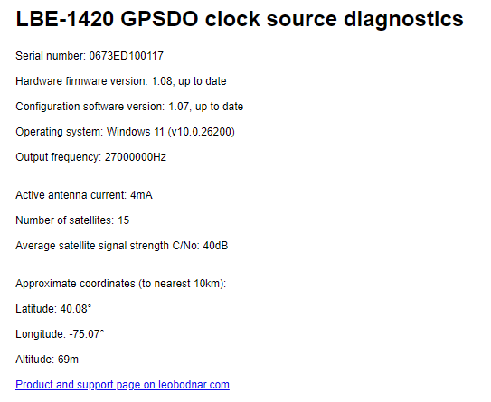

## HF Antenna Options
There are several options for the HF antenna, depending on the nature of your site. 

|  |  |  |  |
| :---: | :---: | :---: | :---: |
| RSEAV-1 (K3LR) | Mag Loop (W8EDU) | SAS (W2NAF) | End-Fed Wire (AD8Y) |

| **Antenna Type**            | **Description**                                                              | **Pros**                                         | **Cons**                                                                          | **User Group**                                           | **Recommended Model**                                                                    |
|-----------------------------|------------------------------------------------------------------------------|--------------------------------------------------|-----------------------------------------------------------------------------------|----------------------------------------------------------|------------------------------------------------------------------------------------------|
| Broadband Ground Vertical   | A tall (8') antenna attached to a 6' ground rod buried 3-4' deep in soil.    | Omnidirectional, relatively low cost.            | Requires driving a ground rod into soil.                                          | Prebuilt node users and builders.                        | [RSEAV-1](https://www.dxengineering.com/part/dx-engineering/dxe-rseav-1/7264263)         |
| Broadband Magnetic Loop     | A 38" circle (think "hula hoop"), typically mounted to the side of a building. | Does not require digging.                        | Expensive; very directional.                                                      | Users in urban and permafrost environments.              | [DXE-RF-PRO-1B](https://www.dxengineering.com/part/dx-engineering/dxe-rf-pro-1b/3548256) |
| Single Antenna System (SAS) | Vertical dipole with active preamplifier.                                    | Differential antenna, rejects ground-loop noise. | Open source hardware, not a commercial product; you have to build it yourself.    | [Homebrewers.](https://en.wikipedia.org/wiki/Amateur_radio_homebrew)                                             | [Documentation here.](http://www.sonic.net/~n6gn/OSHW/BB/SA/SingleAntennaSystem.html)    |
| Wire Antenna                | A wire in a tree.                                                            | Very inexpensive, does not require digging.      | Uneven gain characteristics across broadband HF (less fidelity for science data). | Users with testing, temporary or low-cost installations. | [EF-SWL](https://www.dxengineering.com/part/par-end-fedz/ef-swl/6161445)                 |

### Broadband Vertical Antenna
The [RSEAV-1](https://www.dxengineering.com/part/dx-engineering/dxe-rseav-1/7264263) is an active broadband vertical antenna, and our current default recommendation for the PSWS. ("Active" means that the antenna receives power.)
You can find the manual [here](https://static.dxengineering.com/global/images/instructions/dxe-rseav-1fvi.pdf). Read this section for notes on assembly and installation that are not covered by the manual.

#### Assembly Notes
_Note about applying anti-seize_
_Majid's adapter?_

#### Site Installation Notes
We recommend that you trench the cable in order to make the system more durable in order to protect it from lawnmowers and animals. _Link to info on trenching cables._ However, laying the cable on the ground will work for a temporary or low-cost installation. Because this is an active antenna (receives power), we advise [outdoor coax cable](https://www.truecable.com/products/rg6-quad-shield-outdoor), which has a solid copper core, to limit voltage drop across the cable run. 

### Magnetic Loop Antenna
At a cost of about $800, the [DXE-RF-PRO-1B](https://www.dxengineering.com/part/dx-engineering/dxe-rf-pro-1b/3548256) is much more expensive than the other antennas on this list. However, it's one of the easiest to install, since it doesn't require a ground rod, so this is the right choice if you're on an urban rooftop. We also recommend this antenna for field installations in places where you can't drive the RSEAV-1's ground rod into the soil, such as polar installations or areas with very rocky ground. It's bidirectional, though (as opposed to the vertical, which is omnidirectional) which may make it less effective for some science use.

### Single Antenna System (SAS)
The [SAS](http://www.sonic.net/~n6gn/OSHW/BB/SA/SADeployment.html) is an open-source antenna design by [Glenn Elmore N6GN](https://www.qrz.com/db/N6GN). It's a 6m vertical dipole with an active preamplifier, which uses CAT5 cable for the feedline. It has performed well in initial tests, but is less durable than a commercial off-the-shelf option. If you're interested in experimenting with a DIY antenna (or contributing to this open-source project) then this may be the antenna for you. 

### Wire Antenna
Why not just use an end-fed wire antenna? You can—and this may be a good option if you're demonstrating or testing your PSWS—but the science results won't be as useful because wire antennas are generally optimized for the ham radio bands and so have uneven gain characteristics across the HF spectrum. For best science results, we recommend the broadband vertical.  

## GNSS Antenna
Don't forget that you'll need a GNSS antenna for your GPS-disciplined oscillator! An installation guide can be found [here](https://www.ardusimple.com/gps-gnss-antenna-installation-guide/).
